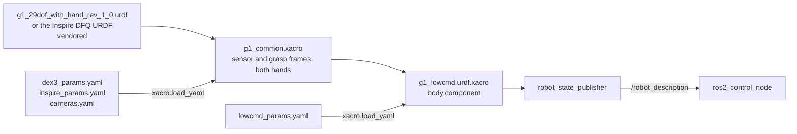

# g1_description

The Unitree G1 robot description: vendored, kinematics-only URDFs plus the xacro wrappers that
add the `ros2_control` blocks for the body motors and the two hands. The hands are either
Unitree's Dex3-1 or Inspire Robots' RH56DFQ, chosen with `hand_model`. `ament_cmake`, no compiled
code.



## Contents

| Path | Purpose |
|---|---|
| `urdf/g1_29dof_with_hand_rev_1_0.urdf` | Unitree's description with the Dex3-1 hands, from [unitree_ros](https://github.com/unitreerobotics/unitree_ros), byte for byte except mesh paths rewritten to `package://`. |
| `urdf/g1_29dof_rev_1_0_with_inspire_hand_DFQ.urdf` | Unitree's description with Inspire RH56DFQ hands, from the same repository and rewritten the same way. Each hand has six actuated joints and six that follow them through `<mimic>` tags. |
| `urdf/g1_common.xacro` | Includes the vendored URDF, adds the sensor and grasp frames and both hand components. Loaded on its own by consumers that want the geometry without the body component. |
| `urdf/g1_lowcmd.urdf.xacro` | Includes `g1_common.xacro` and adds the body component's `<ros2_control>` block. This is the entry point. |
| `config/lowcmd_params.yaml` | The body component's parameters and its per-joint position-only gains. |
| `config/dex3_params.yaml` | The Dex3 components' parameters, shared by both hands, and the per-finger limits. |
| `config/inspire_params.yaml` | The Inspire components' parameters: each hand's serial port in simulation and on the robot, the protocol, the bus rate, speed and force limits, and how each actuator's angle maps to its joint. |
| `config/cameras.yaml` | Where each camera mounts. The URDF builds the chest camera's frames from it and the simulator renders every camera from it, so a camera moves in this file alone. The head entry mirrors Unitree's `d435_joint`. |

Visual meshes are not committed here. CMake copies them at configure time from the simulator's
model, `workspace/vendor/unitree_mujoco/unitree_robots/g1/meshes` when the checkout is there and
the image's `/opt/unitree_robotics/unitree_mujoco/unitree_robots/g1/meshes` otherwise, overridable
with the `G1_VENDOR_MESHES` cache variable. If that directory is missing, the build warns and RViz
shows no robot model.

The YAML files are loaded with `xacro.load_yaml` and expanded into `<param>` tags, because
`ros2_control` hardware plugins only receive parameters that way, never from `controller_manager`'s
own YAML.

## Components and frames

The xacro emits three `<ros2_control>` blocks, or only the body's with `hands:=false`:

| Component | Plugin | Joints |
|---|---|---|
| `G1LowCmdSystem` | `g1_hardware_interface/G1LowCmdSystem` | All 29 body motors, legs and waist included, plus the `imu` sensor. |
| `G1Dex3SystemLeft`, `G1Dex3SystemRight` (`hand_model:=dex3`) | `g1_hand_interface/G1Dex3System` | Seven finger joints each. |
| `G1InspireSystemLeft`, `G1InspireSystemRight` (`hand_model:=inspire`) | `g1_inspire_hand/G1InspireSystem` | The six actuated joints each, in the hand's register order: pinky, ring, middle, index, thumb bend, thumb rotation. |

It also adds frames to Unitree's URDF:

| Frame | Parent | Purpose |
|---|---|---|
| `camera_depth_optical_frame`, `camera_color_optical_frame` | `d435_link` | REP 103 optical frames of the head camera. |
| `chest_camera_link` and its two optical frames | `torso_link` | The chest camera, placed by `cameras.yaml`. |
| `mid360_lidar` | `mid360_link` | Where the Mid360 really points, and the frame its driver stamps: `mid360_link` itself in simulation, pitched 0.2878 rad (16.5 degrees) about y with `hardware:=true`, measured on the robot as the angle between the Livox IMU's gravity and the pelvis IMU's. |
| `mid360_imu` | `mid360_lidar` | The Mid360's built-in IMU, FAST-LIO's body frame. |
| `left_hand_palm_link`, `right_hand_palm_link` | `*_wrist_yaw_link` | With `hand_model:=inspire` only: an empty frame where the Dex3 palm sits, since the arms' MoveIt chains end at the palm. The Dex3 model has the link itself. |
| `left_hand_grasp_frame`, `right_hand_grasp_frame` | `*_hand_palm_link` | Where the hand closes, each hand's own. Pose goals target it rather than the palm origin. |
| `d435_visual`, `chest_camera_visual`, `mid360_visual` | their sensor links | Bodies for RViz. Visual only, so they stay out of MoveIt's planning scene. |

## Parameters

- `config/lowcmd_params.yaml` sets the body component's parameters, described in [g1_hardware_interface](../g1_hardware_interface/README.md#parameters), and a `position_only_kp` and `position_only_kd` per joint.
- `config/dex3_params.yaml` sets the Dex3 parameters, described in [g1_hand_interface](../g1_hand_interface/README.md#parameters), and each finger's `min` and `max`, copied from the URDF.
- `config/inspire_params.yaml` sets the Inspire parameters, described in [g1_inspire_hand](../g1_inspire_hand/README.md#parameters).

The Dex3 hands' `domain_id` and `network_interface` must equal the body component's.

Three xacro arguments pick the target. `g1_bringup`'s `control.launch.py` passes them:

| Argument | Default | Meaning |
|---|---|---|
| `hardware` | `false` | `true` takes the `hardware:` sections of the YAML files: the robot's own DDS domain, the onboard controller released, and the Inspire hands' serial ports on the robot. It also turns on the real Mid360 mount (`mid360_lidar`). `false` is the simulator. |
| `hands` | `true` | `false` leaves out both hand components, for a robot without hands. |
| `hand_model` | `inspire` | `inspire` is Inspire Robots' five-finger RH56DFQ, with Unitree's model of it, which the robot wears; `dex3` is Unitree's three-finger Dex3-1. Either way the stack sees the same palm and grasp frame names. |

## Inspecting the model

```bash
./scripts/manage.sh exec xacro src/g1_description/urdf/g1_lowcmd.urdf.xacro -o /tmp/g1.urdf
./scripts/manage.sh exec check_urdf /tmp/g1.urdf
```

RViz (`rviz:=true` on `bringup.launch.py`) draws the model. The MuJoCo viewer shows the simulator's
own MJCF instead.

## Tests

```bash
./scripts/manage.sh test g1_description   # none of these needs a simulator
```

| Test | Checks |
|---|---|
| `test_lowcmd_xacro` | Expands the xacro, validates it with `check_urdf`, and asserts the `<ros2_control>` blocks. All 29 body joints in SDK order, each with the five command interfaces and its `position_only_*` gains. The Dex3 wire order on each hand, and both Dex3 hands carry the body component's `domain_id` and `network_interface`. The Inspire hands in register order, each command range inside its joint's limits, one serial port a hand. Both hand models name the palm and grasp frames alike and share no hand links. |
| `test_motor_order` | `kG1JointNames` in `g1_hardware_interface` lists the 29 motors in SDK order and names only joints the vendored URDF has. |
| `test_sensor_mounts` | The simulator's compile-time LiDAR mount (`kMountXyz`, `kMountRpy` in `sensor_publisher.cc`) matches the URDF's `mid360_joint`, and the head entry in `config/cameras.yaml` matches `d435_joint`. The simulator links no ROS, so it cannot ask TF where a sensor is. |
| `xmllint_description_g1_description` | Every URDF and xacro is well-formed XML, which xacro does not enforce. |
