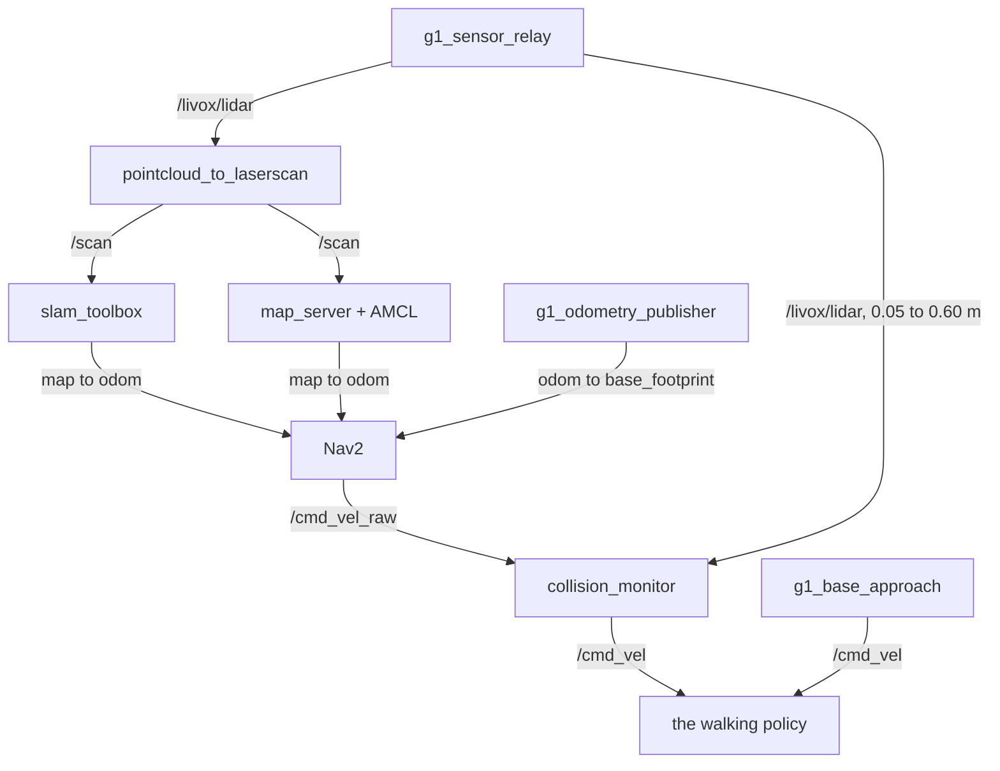

# g1_navigation

SLAM Toolbox mapping, AMCL localization and Nav2 for the G1 on the `unitree_mujoco` track.
Configuration, launch files and glue: the nodes themselves are upstream. `ament_cmake`. The Python is
launch files, tests and `nav_diag.py`, a 20 Hz diagnostic recorder with no part in control.



## Launch files

| File | Purpose |
|---|---|
| `nav_stack.launch.py` | The stack without a simulator: the shared container, the scan pipeline, SLAM or localization, and Nav2 with `nav:=true`. `g1_bringup` includes this. |
| `nav_sim.launch.py` | A simulator, `nav_stack.launch.py` and optional RViz. `test_navigate_to_pose` launches this. |
| `scan.launch.py` | `pointcloud_to_laserscan`, flattening the LiDAR into the 2D scan SLAM and AMCL consume. |
| `slam.launch.py` | `slam_toolbox` in online async mapping mode. |
| `localization.launch.py` | `map_server` and AMCL against the committed map of `world`, or the one `map:=` names. |
| `nav2.launch.py` | Planner, controller, behaviors, BT navigator, collision monitor, lifecycle manager and `g1_base_approach`. With `keepout:=true` also the keepout filter's info server and its own lifecycle manager. Included only with `nav:=true`. |

`g1_bringup`'s `bringup.launch.py` is the operator entry point. `nav_stack.launch.py` and
`nav_sim.launch.py` default to `mode:=mapping` and also take `use_composition` and `container_name`,
which the bring-up entry point does not pass.

`nav_stack.launch.py` stages no simulator. Both callers stage exactly one, and a second would put two
writers on `rt/lowcmd`. `test_launch_threading` asserts it.

`keepout:=true`, on any entry point, turns on the keepout filter in both costmaps and the speed
filter in the global one. `scripts/demos/nervros.sh` sets it.

- The keepout filter reads `/keepout_filter_mask`, an `OccupancyGrid` on the map's grid with keep-out cells at 100. NervROS publishes it from its keep-out zones (`[nav2] keepout_mask` in `g1_bringup/config/nervros/nervros.toml`).
- The speed filter reads `/speed_filter_mask`, each cell the per cent of the top speed a slow zone allows (0 for none), named by the `CostmapFilterInfo` NervROS publishes on `/speed_filter_info` (`[nav2.speed_zones]`). It publishes `/speed_limit`, which the controller follows.
- It is off by default because, enabled with no mask, the filters warn every 2 s.
- The filter info server runs only with it, so the filters subscribe to the mask only then. `nervros-cli doctor` can tell from the mask's readers whether the zones reach Nav2.

## Running

```bash
ros2 launch g1_bringup bringup.launch.py mode:=mapping rviz:=true
```

Drive with teleop and watch the map fill in. `maps/facility` is already committed.
[maps/README.md](maps/README.md) says how to regenerate a map. To navigate:

```bash
ros2 launch g1_bringup bringup.launch.py mode:=localization nav:=true rviz:=true

ros2 action send_goal /navigate_to_pose nav2_msgs/action/NavigateToPose \
  "{pose: {header: {frame_id: map}, pose: {position: {x: 2.5, y: -2.5}, orientation: {w: 1.0}}}}"
```

`mode:=mapping nav:=true` runs Nav2 on the map slam_toolbox is still building, which is what the
world model's exploration does (canopy). A goal can shift a little under a loop closure.

The navigation modes force `sensors:=true`, which brings up the LiDAR, the relay and the `odom` to
`base_footprint` chain. The [navigation guide](../../../docs/guides/navigation-and-moveit.md) walks
through the same steps.

## Gait constraints

The walking policy tracks a proportional fraction of the commanded velocity.

- There is a deadband below about 0.15 m/s on both linear axes. Commanded 0.10 m/s, the robot does not move.
- Yaw has no deadband and tracks near 1:1.
- `g1_controllers` clamps commands to 0.6 m/s and 0.9 rad/s.

Any controller or recovery must therefore command speeds above the deadband. That is why reverse
recovery is removed from both behavior trees: upstream's backup speed (0.05 m/s) sits inside it.
`behavior_plugins` has `drive_on_heading` for `nervros_executor`'s `WalkStraight`, which asks for
0.3 m/s either way. The gait delivers about 0.21 m/s forward and 0.24 m/s back.

Nav2's controller and behaviors publish `/cmd_vel_raw`. `collision_monitor` passes it on to
`/cmd_vel`, slowed so the body would not reach an obstacle within a second.

It reads the LiDAR's cloud in two bands, and never between them, where a hand carries. (A scan source
saw the carried mug and slowed every carry to a stop.)

- 0.05 to 0.60 m, below the costmaps' band, for a crate, a step or a chair's legs.
- 1.05 to 1.40 m, for a wall or a person up close.

The monitor's limits:

- The LiDAR hangs upside down 1.23 m up and looks at most 52 degrees down. So the low band sees nothing nearer than 0.46 m (0.92 m at the floor).
- The monitor forgets what leaves its view. It slows the robot towards a low obstacle seen from afar but cannot stop it there, and nothing sees a table's edge up close.
- Driven at a wall at 0.2 m/s, the low band alone let the robot walk into it. With the high band it stopped 0.43 m short, the monitor asking for 0.08 m/s, less than the gait walks.
- The costmaps, which remember what they saw, stay the main protection.

Its circle is 0.35 m, the body with a margin, not the costmaps' 0.45 m. This leaves the close
approaches Nav2 plans alone.

Beside it, two polygons NervROS shapes from chat (`collision_monitor`): `nervros_slow` slows the
robot to 40% and `nervros_stop` stops it. Both take their shape on `nervros/collision_slow` and
`nervros/collision_stop` (latched) and stay off until shaped, since a polygon with no shape
detects nothing. The robot's own `body` circle is never reshaped.

`navigate_through_poses` is on for NervROS's routes (`WalkRoute`).

The simulated sweep never sees the robot's own links. The real one will see its legs and arms in
these bands, so filter them before trusting it on hardware.

Nav2 is not the only `/cmd_vel` writer. `nav2.launch.py` also starts `g1_locomotion`'s
`g1_base_approach`. It walks the last stretch, because Nav2 stops within 0.5 m of a goal
(`xy_goal_tolerance`), wider than the band the arm reaches from. Nothing arbitrates between the two.
The mission tree runs `NavigateToPose` and `ApproachObject` in sequence, never together.

## Settings worth knowing before changing them

- Nav2 runs uncomposed while the scan and localization nodes compose. Composed, the costmaps come up on `Costmap2DROS` defaults instead of the params file, and `controller_server` hangs activating. So `nav2.launch.py` rejects `use_composition:=true`, and `nav_stack.launch.py` always passes `false`.
- `z_voxels` is 16, the voxel grid's maximum, so the column height comes from `z_resolution`: 16 x 0.125 m = 2.0 m. The column must contain the sensor at 1.22 m, or `VoxelLayer` rejects every cloud.
- `obstacle_max_range` is 3.0 m, well inside the sensor's reach. Attitude error times range is height error, so distant floor returns cross `min_obstacle_height` and mark as obstacles. The value is the simulator's. Re-measure it on the robot.
- `obstacle_min_range` is 0.6 m. It keeps the carried object and the robot's own arms off the costmap. Anything the base can hit shows up beyond it.
- AMCL uses `OmniMotionModel` because the robot strafes: `g1_base_approach` commands lateral velocity and the gait drifts sideways. The alphas stay at Nav2's defaults, since neither simulated odometry source says anything about the real robot's noise.

## Configuration

| Path | Contents |
|---|---|
| `config/nav2_params.yaml` | Planner, controller, costmaps, behaviors, BT navigator, collision monitor. |
| `config/localization.yaml` | `map_server` and AMCL. |
| `config/scan.yaml` | The point cloud to laser scan flatten, including the height band. |
| `config/slam_mapping.yaml` | `slam_toolbox` online async. |
| `config/g1_navigation.rviz` | RViz for the navigation modes. Fixed frame `map`. |
| `config/navigate_to_pose.xml`, `config/navigate_through_poses.xml` | Behavior trees, with reverse recovery removed. |
| `maps/facility.{yaml,pgm}`, `maps/apartment.{yaml,pgm}` | The committed maps of the `navigation` and `apartment` worlds. |

`g1_navigation.rviz` has a Nav2 group and a folded Sensors group. `g1_bringup`'s `g1_sensors.rviz`
carries the same Sensors group with fixed frame `odom` for `mode:=none`, where no `map` frame
exists. The config lives here because its AMCL particle display comes from `nav2_rviz_plugins`, a
dependency `g1_bringup` should not take.

## Tests

```bash
./scripts/manage.sh test g1_navigation
./scripts/manage.sh test --sim g1_navigation   # the suites that need a simulator
```

| Test | Needs a simulator | Covers |
|---|---|---|
| `test_navigate_to_pose` | yes | The acceptance gate: the robot reaches a goal on its own, stays upright, and never trips the emergency freeze with the full sensor pipeline running. |
| `test_scan_pipeline` | yes | The frame chain and the scan. |
| `test_slam_map` | yes | slam_toolbox owning `map` to `odom`, and the map's geometry. |
| `test_launch_threading` | no | Arguments surviving every include boundary, for both callers: the include set, the container, the uncomposed Nav2 pin, and that no simulator is staged. |
| `test_no_sim_time` | no | No shipped config enables `use_sim_time`. There is no `/clock` on this track. |

`test_navigate_to_pose` drives the real gait and is timing-sensitive. It has no retry wrapper, so a
flaky rate stays visible. Re-run it alone before believing a red run:

```bash
ctest --test-dir build/g1_navigation -R '^test_navigate_to_pose$'
```

## Soak test

`nav_soak` brings the stack up, drives a list of goals across the facility one at a time, records
health, and tears everything down.

```bash
ros2 run g1_navigation nav_soak                        # default goal list
ros2 run g1_navigation nav_soak --rviz
ros2 run g1_navigation nav_soak --goals "3.0 -3.0,-2.5 2.0"
ros2 run g1_navigation nav_soak --odometry ground_truth
```

It reports:

- Distance driven.
- The share of Nav2 commands inside the gait deadband.
- `map` to `odom` correction sizes.
- Pelvis pitch and local costmap lethal-cell counts.
- The falls, progress failures and recoveries counted in the launch log.

`nav_diag.py` is the recorder. It also runs on its own against a stack that is already up, for the
given number of seconds (default 200):

```bash
ros2 run g1_navigation nav_diag.py 200
```

`nav_soak` works around three things:

- One goal at a time, each allowed to finish. A goal preempted mid-run replans abruptly and the robot can fall.
- Teardown by process group plus a `/proc/PID/cmdline` sweep. Processes running as `python3` or the `ros2` CLI otherwise survive as orphans into the next run.
- Readiness read from the launch log. Discovery can outlast any timeout, and AMCL publishes `/amcl_pose` only after the robot moves.

It checks for orphans before and after a run. After an interrupted run, check by hand: any output
from `ros2 node list --no-daemon | sort | uniq -d` means an orphan is still running.
