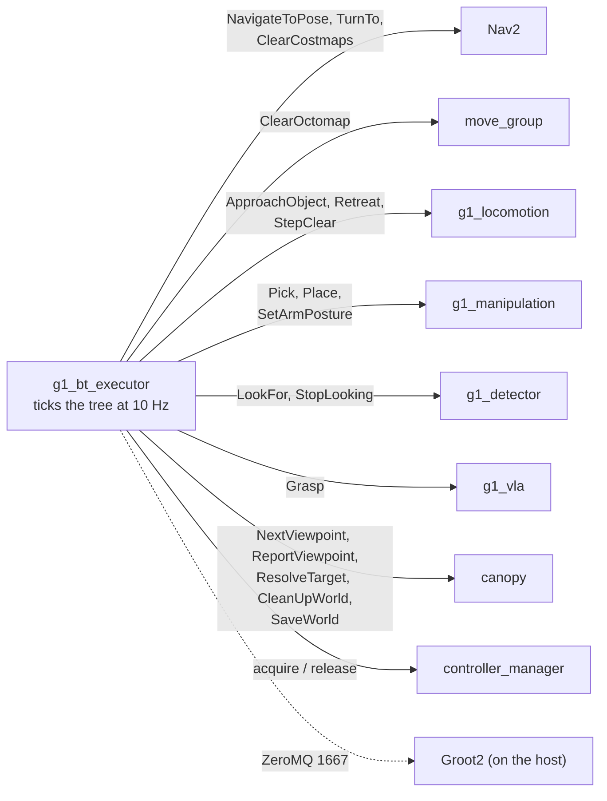

# g1_orchestration

Runs behavior trees that compose navigation and manipulation into a mission, on BehaviorTree.CPP v4.
`ament_cmake`, C++20.

Two executors share the leaves:

- `g1_bt_executor` runs a hand-written tree from a file, then exits.
- `nervros_executor` is a long-lived node. A NervROS agent sends it missions.



The tree decides what happens and in what order. The skills decide how. Nothing here plans or moves
a joint.

Nav2 links the same BehaviorTree.CPP library. BehaviorTree.ROS2 is not in the image, so this package
has its own action-client base.

## Layout

| Path | What it is |
|---|---|
| `include/g1_orchestration/skills/`, `src/skills/` | One header and one source per skill. Leaves that belong together share a file: `look_for`, `arm_authority_leaves` and `world_model_leaves`. |
| `ros_action_node.hpp`, `skill_action_node.hpp`, `service_leaf.hpp` | The bases. `RosActionNode` owns goal handling, cancellation and the wait for the server. `SkillActionNode` adds `judgeResult` for the `success`/`message` convention, so most leaves need only `fillGoal`. `ServiceLeaf` is for a call that finishes in one tick. |
| `ports.hpp`, `port_types.hpp` | Ports used by more than one leaf, and the `Station` (`x;y;yaw`) and `Point3` (`x;y;z`) port types. |
| `arm_authority.hpp`, `src/arm_authority.cpp` | Acquiring and releasing the arm and hands. |
| `registration.hpp`, `src/registration.cpp` | Binds classes to the names trees use. |
| `nervros_executor.*`, `mission_observer.*`, `server_fleet.*`, `authority_port.*` | The mission executor: the node, what it watches in a running tree, the action servers StopAll reaches, and the seam to `controller_manager`. |
| `mission_validator.*`, `catalog.*`, `macro_library.*`, `sha256.*` | Decide whether a mission may run and what it may name. They use no ROS, so a service thread and the mission thread share them. |
| `config/catalog.yaml`, `trees/library/` | The skills a mission may use, and the macro subtree each one runs. |

## Leaves

| Leaf | Wraps | Ports |
|---|---|---|
| `NavigateToPose` | Nav2 `/navigate_to_pose` | In: `goal` as `"x;y;yaw"`, `frame_id`, `behavior_tree`. Out: `goal_yaw`. |
| `ApproachObject` | `/g1_base_approach/approach_object` | `object_id`, `arm`, `working_yaw`, `use_current_heading`, `timeout_s` |
| `Retreat` | `/g1_base_approach/retreat` | `distance`, `timeout_s` |
| `StepClear` | `/g1_base_approach/step_clear` | `clearance`, `timeout_s`. Succeeds at once when already clear, so it can run before every Nav2 motion. |
| `Pick` | `/g1_manipulation_server/pick` | `object_id`, `arm` |
| `Place` | `/g1_manipulation_server/place` | `arm`, and either `surface` (preferred) or `target` as `"x;y;z"` with `frame_id`. |
| `SetArmPosture` | `/g1_manipulation_server/set_arm_posture` | `group`, `named_target` |
| `MoveHand` | `/g1_manipulation_server/move_hand` | `arm`, `offset_x`, `offset_y`, `offset_z`, `mode` (`point` or `reach`), `speed`, and either `target` (a world-model object, by id or words, looked up with `find_service`) or `frame` (one of the robot's). For pointing and gestures. |
| `Wait` | nothing | `seconds`, 0 to 60. Answers RUNNING while it waits, and fails at once when the mission winds down. |
| `ClearCostmaps` | Nav2 costmap clear services | `timeout_s`, `global_service`, `local_service` |
| `ClearOctomap` | MoveIt `/clear_octomap` | `timeout_s`, `service` |
| `AcquireArm` / `ReleaseArm` | `controller_manager` services | `timeout_s` |
| `LookFor` | the detector's `phrases`, then `/objects` | In: `objects` (`id` or `id=phrase`, comma-separated, waited on), `also` (asked for, not waited on), `detector`, `timeout_s`. Out: `first_id`, the first entry's id as the detector reports it (`O17` is `o17`). Answers RUNNING while it waits. |
| `StopLooking` | the detector's `phrases` | `detector`, `timeout_s`. Empties the list, which idles the detector. |
| `Grasp` | `/g1_vla_server/grasp` | `instruction`, `object_id`, `arm` |
| `NextViewpoint` | `/canopy/next_viewpoint` | In: `mode` (`frontier` or `coverage`), `retry_s`, `timeout_s`. Out: `goal`, `headings`, `viewpoint_id`, `room_id`, `outcome`. `outcome` is `viewpoint`, `stuck`, `done` or `error`. Fails on `done` or `error`, which ends a viewpoint loop. On `stuck` it succeeds, and the tree steps clear before asking again. |
| `ReportViewpoint` | `/canopy/report_viewpoint` | `viewpoint_id`, `reached` |
| `ResolveTarget` | `/canopy/get_approach_pose` | In: `target` (object id, room, or label), `room`, `standoff`. Out: `goal`, `yaw`, `target_id`. |
| `CleanUpWorld` | `/canopy/clean_up` | `timeout_s`. Takes out what canopy can tell is not an object, marked so a person can restore it. |
| `SaveWorld` | `/canopy/save` | `timeout_s` |
| `TurnTo` | Nav2 `/spin` | `yaw` in `frame`, `base_frame`, `yaw_rate`, `slack_s`. Turns by the difference from the current heading. |
| `DriveStraight` | Nav2 `/drive_on_heading` | `direction` forward or backward, `distance` 0.1 to 2 m, `speed` (0.3, kept within 0.2 to 0.4), `slack_s`, `coast_m` (0.1, the gait's run-on after the stop, taken off the distance). Fails on Nav2's collision stop. |
| `TurnBy` | Nav2 `/spin` | `degrees` -180 to 180 (positive left), `yaw_rate`, `slack_s`. A relative turn, no TF. |

Leaves that wrap an action server also take `server_timeout_s` (default 10.0): how long to wait for
the server to appear. Every port and its default is in the Groot2 palette,
`trees/g1_orchestration_nodes.xml`.

How the leaves behave:

- Action leaves send their goal on the first tick, answer RUNNING while it is in flight, and cancel the goal when halted.
- Leaves built on `SkillActionNode` log the server's own reason when a skill fails.
- `ReleaseArm`, `ClearCostmaps`, `ClearOctomap`, `StopLooking` and `ReportViewpoint` always return SUCCESS, so cleanup cannot fail a tree. A failed call is only logged.

`ApproachObject` requires either `working_yaw` or `use_current_heading`. Pass the staging goal's
`goal_yaw` rather than retyping the number:

```xml
<NavigateToPose goal="4.30;-5.60;1.5708" goal_yaw="{workbench_yaw}"/>
<ApproachObject object_id="red_block" working_yaw="{workbench_yaw}"/>
```

## Adding a skill

A skill is a ROS action served by the package that owns that domain, plus a leaf here that calls it.
Anything that writes a velocity belongs in `g1_locomotion`. Anything that moves the arm belongs in
`g1_manipulation`. The leaf only calls them.

1. Define the action in `g1_msgs` and add it to that package's `CMakeLists.txt`. Give the result a `success` and a `message` so the leaf can use the shared result judging.
2. Implement the server in the owning package, not here.
3. Add the leaf, a header and a source under `skills/`.
   - Derive from `SkillActionNode`, which already judges the `success`/`message` result. Write a constructor that names the action, `providedPorts()` and `fillGoal()`.
   - Derive from `RosActionNode` instead when the result is not that shape, as Nav2's is not.
   - Derive from `ServiceLeaf` and override `call()` for a call that finishes in one tick.
   - `skills/pick.cpp` and `skills/clear_octomap.cpp` are minimal examples.
4. Register it in `src/registration.cpp` with `registerLeaf<OpenDoor>(factory, "OpenDoor", context)`, and list the source in `CMakeLists.txt`.
5. Rebuild, then regenerate the Groot2 palette from the workspace root:

```bash
ros2 run g1_orchestration g1_bt_node_model src/g1_orchestration/trees/g1_orchestration_nodes.xml
```

Port descriptions become Groot2's tooltips, so write them for a tree author. `test_node_model` fails
if the palette drifts. `test_tree_loads` fails if a tree names a leaf nobody registered.

## Trees

| Tree | Needs | What it does |
|---|---|---|
| `pick_and_place.xml` | Nav2, `world:=navigation`, perception | Acquire, tuck, drive to a staging pose, look, close the last gap, pick, back off, drive to storage, look, close again, place, back off, tuck, release. |
| `pick_and_place_in_place.xml` | `world:=manipulation` | Pick the block, put it down at a fixed `odom` target, tuck, release. No driving. |
| `sort_into_box.xml` | `world:=tabletop`, perception | Pick the red block from a cluttered table and drop it in the box. |
| `vla_grasp_in_place.xml` | `world:=manipulation`, `vla:=true` | The learned grasp in place of a planned pick. |
| `explore.xml` | Nav2, canopy's world model, a detector | Walks to frontiers until the LiDAR map is closed, then to camera viewpoints until every room has been seen, then cleans up and saves the world. Steps clear of furniture before each Nav2 motion. |
| `TuckBothArms` | subtree of `pick_and_place.xml` | Both arms to `tucked`, each retried. One leaf per arm, because `both_arms` fails to execute a named posture on this stack while either arm alone succeeds. |

## The mission executor

`nervros_executor` runs the behavior trees an agent compiles from a plan, one mission at a time, and
reports what it does. `g1_bt_executor` cannot do this. One process per tree has no status, no cancel
but a signal, and no idea what the hands hold.

The agent is [NervROS](https://github.com/Adyansh04/nervros). The contract is its
`nervros_interfaces`.

| Interface | Name | Notes |
|---|---|---|
| Action | `/nervros_executor/execute_mission` | `ExecuteMission`. Modes: execute, validate (load and check only), and dry run (every leaf replaced by a stand-in that waits its share of the skill's catalog time). |
| Service | `/nervros_executor/validate_mission` | The same checks without a goal, plus a load. Returns the worst-case duration. |
| Service | `/nervros_executor/get_catalog` | The skills as JSON, the palette (`TreeNodesModel`: every leaf's ports and the skills' subtrees), BehaviorTree.CPP's version, and the catalog's version, which changes with the skills and with the palette. |
| Service | `/nervros_executor/stop_all` | Halts the mission, cancels goals on every skill server, holds posture. Safe at any time. |
| Service | `/nervros_executor/pause_mission` | `PauseMission`: pauses the running mission, or resumes it (below). |
| Service | `/nervros_executor/define_skill` | `DefineSkill`: a skill an agent teaches, checked and served as a draft, or kept (below). |
| Service | `/nervros_executor/forget_skill` | `ForgetSkill`: drops a taught skill, and its file when it was kept. |
| Topic | `/nervros_executor/robot_state` | `RobotState`, reliable and transient local, on change and at 1 Hz. |

### What a mission may say

A mission is one `Mission` tree of `Sequence`, `Fallback`, `RetryUntilSuccessful` (1 to 3 attempts),
`Timeout` and `ForceSuccess` around `SubTree`s of the catalog's skills, and nothing else. This is an
allowlist because a model must be able to arrange the macros in `trees/library` and never write a
leaf.

The rules:

- The document defines no other tree. BehaviorTree.CPP would let it redefine a registered macro, so the executor registers its own copies with each mission's factory.
- It has no `<include>`.
- It carries `tree_sha256`, the lowercase SHA-256 of the exact bytes of `tree_xml`. An empty hash does not match.
- It has no `Parallel`, reactive nodes, `Repeat`, `Script`, `SetBlackboard`, `AcquireArm` or `ReleaseArm`.
- It has no pre or post condition attribute (`_skipIf`, `_post`, ...).
- It has no leaf written directly.
- Each skill gets exactly its catalog arguments, in the shape it needs, or an earlier step's output (below).
- Depth, node count, step count (each step is a whole macro at load time) and size are capped.
- The worst case is capped too. A mission that could run past `max_duration_cap_s` is turned away (`TOO_LONG`) instead of being cut off half done by the watchdog.

Problems come back as `{code, line, node, message}` in `diagnostics_json`, worded so the model can
fix its plan. The codes are in `mission_validator.hpp`.

The worst case:

- A `Sequence` and a `Fallback` sum their children. A fallback may try every branch, and a watchdog set from the slowest would fire on a mission still working.
- A retry multiplies by its attempts.
- Each `Timeout` caps what is inside it.
- A skill counts for its catalog `max_duration_s`, which is also the `Timeout` its macro is wrapped in.

### Skills

`config/catalog.yaml` is what a planner is told. `trees/library/` is what runs. `test_catalog_drift`
keeps them in step (names, ports, limits, resources). The macros are flat: none names another.

| Skill | Does | Needs |
|---|---|---|
| `GoToTarget` | Resolves a world-model id (`R2`, `O17`), or plain words for the nearest match (`red mug`), to a pose facing it. Then clears costmaps, steps clear of furniture, walks (three tries) and squares up. Hands on `target_id`, the id it walked to. | `base` |
| `GoToPose` | The same walk to `x;y;yaw` in the `map` frame. | `base` |
| `PickObject` | Needs the hand empty. Asks the detector for the object, closes the last stretch, picks, idles the detector, backs off 1.2 m. | `base`, arms |
| `PlaceInto` | Needs the hand to hold something. Asks the detector for the container and for what the hand holds, closes in, places, backs off. | `base`, arms |
| `PlaceOn` | Needs the hand to hold something. Asks the detector for the surface and for what the hand holds, closes on the surface's nearest edge, sets the object down where the hand reaches on a surface wider than a container, backs off. | `base`, arms |
| `WalkStraight` | Walks forward or backward a distance (0.1 to 2 m) with `DriveStraight`, one try. Nav2 projects the walk on the local costmap and stops it before a collision, which fails the step. | `base` |
| `TurnInPlace` | Turns by an angle (-180 to 180 degrees, positive left) with `TurnBy`, one try. | `base` |
| `TuckForTravel` | Tucks each arm whose hand is empty. | arms |
| `ArmTo` | Moves one arm (`left_arm`, `right_arm`) to a named pose of `g1.srdf` with `SetArmPosture`, one retry. | arms |
| `HandTo` | Brings one hand 10 cm over an object within reach, about 0.48 m from the shoulder (an id, or plain words for the nearest), with `MoveHand`, without grasping. | arms |
| `FindInView` | Asks the detector for a phrase and waits for it on `/objects`, then idles the detector. Moves nothing. Hands on `object_id`, the name the detector reports it under (`red_mug`). | none |
| `ExploreBuilding` | The loop of `trees/explore.xml`: frontiers until the map is closed, then canopy's viewpoints until every room is seen, then clean up and save. Explores for up to 23 minutes, since a whole run is longer than a mission may be, and saves. Running out of time is not a failure. A world model that cannot plan is. | `base` |

An argument with `format: number` takes a decimal from its `min` to its `max`. The validator checks
the range, and the catalog JSON carries it. In the simulator, a 1 m walk ended within 1 cm and a 90
degree turn within about 5 degrees.

`object_id` and `container_id` take a world-model id (`O17`) or, where there is none, the name the
detector reports (`red_block`).

- The detector names what it finds by the lowercased id (`o17`). `LookFor` hands that on as `first_id`, and the leaves after it use it.
- `phrase` is the words the detector looks for. The planner fills it from the world model's label (`default_from` in the catalog).
- The mock detector matches on the id only, so in the simulator the id must be the simulator's name.

A skill's `outputs` are ports of its macro that a later step can take. The step hands one on under
its own step's key, `target_id="{s1_target_id}"`. A later step's argument is that key,
`object_id="{s1_target_id}"`.

The validator checks that:

- The key is written once.
- A step earlier in the document writes it. That step must run to its end: not under a `ForceSuccess`, and not in a `Fallback` branch the step taking it is not in.
- The output fits the argument: an id from the world model for a `world_id`, an id for an `id`, the same format otherwise, never a catalog `enum`.

An `arg_choices` list takes what a step found on the robot, a name the robot knows, but not a world
model's id.

A dry run seeds every output key, since the macros' scripts read them.

### Taught skills

An agent may teach the robot a skill that none of the catalog's does, such as pointing at something
or looking around a room. It does so through `define_skill`.

<details>
<summary>Rules for a taught skill's body</summary>

A taught skill's body is held to more than a person's macro:

- It uses only `Sequence`, `Fallback`, `RetryUntilSuccessful` (1 to 3), `Timeout` and `ForceSuccess` around the `learnable_leaves`. Their servers check every goal themselves (Nav2 with its costmaps and the keepout filter, MoveIt against the scene, the bounded walk and turn, the detector, a wait).
- On each leaf it sets only the inputs `learnable_leaves` lists, so which server, frame or timeout a leaf uses is never the skill's to change.
- Of inputs listed `a|b` it sets exactly one: MoveHand takes a `target` or a `frame`, never both or neither.
- A `world_id` argument feeds only an input listed as `input(world_id)`, MoveHand's `target`, so an object's id never goes in as a frame.
- An input listed `input=a/b` takes only those values: a literal must be one, and an argument fed to it is published with them as its `enum`, so a plan that passes MoveHand's `arm` as `left_arm` is refused when it is checked, not when it runs.
- Every attribute is a literal or one of the skill's own arguments (`arm="{arm}"`), and every argument feeds some input: one the body never uses would take a plan's value and do nothing with it. No argument may be called `name`, which a `SubTree` keeps for its step.
- Depth, size and time (1 s at least) are capped.
- The name may not be one of a skill, a macro or any node the executor registers.
- Its resources follow from its leaves.
- Its body is wrapped in a `Timeout` of its time, as a library macro is.

</details>

A taught skill that moves an arm runs only while both hands are empty, as `TuckForTravel` does. An
arm swung with something in its hand could drive it into the body.

A new skill is a draft.

- It is served, with `learned: draft` and what it was `taught_for` in the catalog, until the executor stops.
- The agent keeps it (`keep`, the same request again) after a mission that used it succeeded.
- A kept skill is written to `learned_skills_dir` as `<name>.json`. It loads with the executor and is checked again. One whose leaf has gone, or whose file is named for another skill, is left out with a warning.
- A draft never replaces a kept skill. Forget that one first.
- Forgetting removes the file whatever the executor held.
- A mission is checked and run against the skills as they were when it started. A define or a forget meanwhile serves the next one.

`GetCatalog`'s JSON also carries `learnable`: each leaf with its ports and the authority it takes,
and its `one_of` groups and `world_ids` inputs, for the agent to teach from and check a body
before the operator is asked.

### Authority

The arms and both hands are taken once, before the first tick, when any skill needs them. They are
not taken per skill, because a released Dex3 hand goes limp and drops what it holds. `base` is a name
only.

However a mission ends (success, failure, cancel, watchdog, exception, stop), the arms are released
only if no hand holds, or may hold, something. Otherwise they are kept, `RobotState` says so, and the
next mission that needs them finds them held.

`Pick` and `Place` results say what a hand holds (`holding_left`, `holding_right`, in the mission's
own ids). `resources_held` lists `base`, `left_arm`, `right_arm`.

The mission's root blackboard keeps the same information as `held_left` and `held_right`
(`id=phrase`, with the id the detector knows it by, kept current as the mission picks and places).
The skills rely on it:

- `Place` checks where the held object lands on `/objects` after the release, so `PlaceInto` and `PlaceOn` ask the detector for it; one it cannot see again counts as placed, unconfirmed.
- `TuckForTravel` must not fold an arm that holds something.
- `PickObject` and `PlaceInto` fail at once, before anything moves, on a hand that is full or empty the wrong way round.

<details>
<summary>Unknown hands</summary>

A hand can also be *unknown*: the blackboard holds `?` and `RobotState.message` says "unknown". It may
hold something the executor cannot name. A hand is unknown in two cases:

- The arms were already taken before this executor found them (it restarted while a hand held an object).
- It is the arm of a `Pick` that was halted while it ran, since the hand may have closed before the cancel arrived.
- Its fingers stood closed when the arms were about to be let go of, at a mission's or a lend's
  end: a borrower's grip or a grasp policy may have closed it on something. The fingers are read
  once from `/joint_states` (`finger_joints` past `finger_closed_rad`); with no reading within
  `finger_read_timeout_s`, both hands count as closed.

An unknown hand counts as full:

- The arms are kept.
- `TuckForTravel` skips it.
- `PickObject` refuses it.
- `PlaceInto` and `PlaceOn` may use it.

It stops being unknown when a `Place` with that arm succeeds. It also stops when a later mission finds
the arms free again because someone let go of them (`deactivate_arm`, once the hands have been looked
at).

A stack whose bringup activates the arms (`activate_arm:=true`) needs `hands_empty_on_attach:=true`.
Otherwise the first mission finds them taken and trusts nothing.

</details>

### Stopping

`StopAll` does not wait on anything slow:

1. The mission thread halts the tree, which cancels its leaves' goals. The leaves are also told to start nothing more. One flag does this, set by a stop, a cancel, the watchdog or a shutdown. A tick that is inside a wait for a server, or looping through retries, then ends at once instead of running out its budget.
2. Every goal on every server in `stop_action_servers` and `agent_action_servers` is cancelled, whoever sent it. Arms lent to NervROS are taken back. So is the arm trajectory controller's goal, which then holds the arm where it is (no snap).
3. It waits up to `stop_wait_s` for the halt and asks again for any goal accepted since. Then it waits for the servers' status topics, the arm controller's included, to show no goal.
4. The base needs nothing more. Nothing writes `/cmd_vel`, and the policy zeroes a stale command after 0.5 s and stands. **The hands are never touched**: cancelling a hand controller's goal would loosen the grip.
5. It returns `ok`, a message and `state_after` (`holding posture; right hand keeps red_block`). It sets `RobotState.stopped` until the next executed mission starts.

`ok` is false in two cases:

- The mission thread has not halted in time. It can be inside a controller_manager call, which nothing interrupts.
- A server still has a goal in flight after the wait.

`message` says which, and how many servers were actually asked.

g1_manipulation checks for a cancel between the phases of a pick and between lift attempts. Once the
hand has closed on the object, a cancelled pick keeps it, so stopping during the grasp or the lift
does not drop it. The executor still counts that hand as unknown, since a halted leaf gets no result.

### Pausing

`PauseMission` with `pause: true`:

1. Closes a gate that the action leaves look at before they send a goal.
2. Halts the running step, from the decorators around it down, which cancels its goals. The step is the one named `s<N>_...`, or whichever runs.
3. As a stop does, asks again for any goal accepted after the halt and cancels the arm trajectory controller's goal.

Nav2 stops the base and the controller holds the arm. The hands are not touched.

- A step whose skill has `risk: manipulation` (a pick or a place) is let end first. The gate holds the next step until then.
- Paused, the mission thread ticks nothing. It still answers a stop, a cancel, the deadman and the robot's health.
- The watchdog does not count the pause and gives back the time the halted step had run. `max_pause_s` ends a forgotten pause.

`pause: false` opens the gate and ticks again:

- The halted step starts from its beginning, with a fresh timeout.
- `DriveStraight` and `TurnBy` keep the distance or angle their feedback reported (the walk adds its coast, at most what it walked). A resumed `WalkStraight` or `TurnInPlace` therefore does only the rest.

Reporting:

- `RobotState.paused` and the feedback's `paused` turn true once the robot has stopped. Until a pick or place ends they stay false, and `message` says "pausing once s3_PickObject ends", then "paused during s2_GoToPose".
- A tree with a `Timeout` around the whole mission keeps counting it while paused. NervROS's trees have none.

### Results and events

The result has `outcome`. For anything but success it also has `failed_node`, `failed_step_id` (the
`s<N>` of the step's `s<N>_<Skill>` name) and `failure_reason`, the skill server's own message. The
node is the last leaf to fail before the tree did, so a failure a retry recovered from is not blamed.

A `Timeout` that ran out, the step's or the macro's, is `OUTCOME_TIMEOUT`, like the watchdog. A cancel
or stop is `OUTCOME_CANCELED`. Both name the step that was running.

`cause` says when the robot or the executor ended the mission rather than the plan: `CAUSE_ROBOT`
(refused by the health gate, or a fall mid-walk), `CAUSE_DEADMAN`, `CAUSE_SHUTDOWN`,
`CAUSE_NO_SERVER` (a leaf's action server was not up), `CAUSE_TELEOP` and `CAUSE_BUSY`. A stop or
cancel a client asked for is `CAUSE_NONE`, as is any failure of the plan's own. NervROS leaves such
runs out of the skills' track records. `RobotState.boot_id` is new each time the executor starts.

Feedback carries the running nodes and the status transitions since the last message.
`event_level: steps` keeps the step subtrees and the leaves that do something. `all` keeps every
node. A halt shows as RUNNING to IDLE.

The result's `outputs_json` holds what the steps handed on (`{"s1_target_id": "o17"}`), so an agent
that waits on a mission can use what it found.

`StopAll` and `ValidateMission` answer while a mission ticks, because the mission runs on a thread of
its own.

### Parameters

All in `config/nervros_executor.yaml`, commented there.

| Parameter | Default | Meaning |
|---|---|---|
| `tick_rate_hz` | 10 | Tick rate. |
| `max_duration_cap_s`, `watchdog_factor` | 1800, 1.2 | The most any mission may run, and the most its worst case may come to. A goal with no limit gets its worst case times the factor. |
| `groot2_port` | 0 | Groot2 monitoring. 0 (the default) disables it. A debugging aid for a developer's own machine: it binds every interface, has no authentication, and Groot2's hooks can block or override a running node. Never use it on a network anyone else can reach. |
| `hands_empty_on_attach` | false | When the arms are found already taken, trust the hands to be empty (a simulator that activates them at bringup) instead of treating them as unknown. |
| `arg_choices` | `""` | `Skill.arg=a\|b;...` limits those arguments to those values, which the served catalog lists and the validator checks. Used where the simulator's mock detector finds objects by body name only, to list the names it knows (`PickObject.object_id=mug_4;PlaceInto.container_id=tray_1;FindInView.phrase=mug\|tray` in the apartment). |
| `catalog_file`, `macros_dir` | `config/catalog.yaml`, `trees/library` | Relative to the package share directory. |
| `event_level` | `steps` | `steps` or `all`. |
| `max_tree_depth`, `max_tree_nodes`, `max_tree_steps`, `max_xml_bytes` | 10, 200, 32, 131072 | Bounds on a mission's text. |
| `feedback_period_s`, `cancel_settle_s`, `stop_wait_s` | 0.25, 0.5, 3.0 | Feedback rate. Spin after a halt so cancels reach their servers. The most a stop waits. |
| `max_pause_s` | 600 | The longest a mission may stay paused before it ends (`OUTCOME_CANCELED`). |
| `authority_timeout_s` | 15 | Per-step budget for `controller_manager` calls. |
| `finger_joints`, `finger_closed_rad`, `finger_read_timeout_s` | each hand's index and middle base joints, 0.3, 2.0 | A hand whose finger joints stand past this when the arms are about to be let go of counts as holding something, and keeps its arm held. |
| `dry_run_time_scale`, `dry_run_min_leaf_s` | 0.02, 0.05 | A dry run's share of a skill's catalog time per leaf, and its floor. |
| `stop_action_servers` | every skill server | As `/name:type`. `test_catalog_drift` fails if a leaf uses one that is not listed. |
| `agent_action_servers` | NervROS's own motions' servers | As `/name:type`: the servers NervROS sends its own steps to (routes, waits, MoveIt moves). `StopAll` cancels their goals too. |
| `max_lend_s`, `lend_heartbeat_timeout_s` | 120, 2.0 | `LendResources`: the longest the arms are lent for one of NervROS's own arm moves, and how long its heartbeat may stop before they are taken back. |
| `arm_controller_action` | the arm trajectory controller | Cancelled by `StopAll` to hold the arm. |
| `learnable_leaves` | nine leaves | What a taught skill may be built from, as `Leaf:holds:inputs`: the authority it needs (`base`, `arms` or empty) and the only inputs a skill may set. `a\|b` lists two of which exactly one is set; `input(world_id)` marks one that takes a world-model id. |
| `max_learned_duration_s`, `max_learned_nodes`, `max_learned_skills` | 300, 40, 32 | The longest and largest a taught skill may be, and how many there may be. |
| `learned_skills_dir` | `""` | Where kept skills live, a JSON file each. Empty keeps them only until the executor stops. `nervros.sh` uses `/root/data/skills/g1`. |

`~/lend_resources` (`LendResources`) lends the arms to an arm move NervROS runs itself through
MoveIt: they are taken as for a mission, missions and driving by hand are refused while they are
lent, and they are let go of as at a mission's end when given back, on `StopAll`, on a heartbeat
silent for `lend_heartbeat_timeout_s`, or after `max_s` (at most `max_lend_s`). A hand that holds
something keeps its arm held.

### Running it

The launch file also starts `nervros_watchdog` (`config/nervros_watchdog.yaml`), which cancels
NervROS's own goals and stops MoveIt if NervROS goes quiet with a motion running.

```bash
ros2 launch g1_orchestration nervros_executor.launch.py
ros2 run g1_orchestration send_mission.sh src/g1_orchestration/trees/missions/pick_and_place.xml dry-run
```

It starts nothing else: the stack has to be up, as for `g1_bt_executor`.

Give it 30 s or more to shut down (the launch does). It halts the mission, waits for the servers and
hands the arms back.

`send_mission.sh` hashes a file and sends it with `ros2 action send_goal --feedback`. The second
argument is `execute` (the default), `validate`, `dry-run` or `check` (the service). A third is the
limit in seconds.

`trees/missions/pick_and_place.xml` is a mission as the agent writes them, the one the simulator ran.
A test keeps it valid.

## The arm bracket belongs to the executor

The manipulation trees take the arm with `AcquireArm` first. `g1_bt_executor` releases the arm and
hands on every exit path (success, tree failure, an exception while loading, SIGINT or SIGTERM)
through an RAII guard around the whole tree; `nervros_executor` keeps them while a hand holds
something (see Authority). `ReleaseArm` also exists as a leaf for handing the arm back early.

Acquiring trades `arm_freeze_controller` for `arm_trajectory_controller` in one `STRICT`
`switch_controller` call.

- The hardware component leaves unclaimed joints unpowered, so two calls would drop the arms in between.
- `BEST_EFFORT` can silently apply only the deactivation.
- `STRICT` refuses a switch that is already done, so both controllers' states are read first. `planArmSwitch` makes that decision without service calls, which is why it is unit-tested.

The hands are separate component activations and keep `BEST_EFFORT`, so a hand that will not come up
still leaves the arm usable.

## Running

The mission starts nothing else. The simulator, Nav2, MoveIt and the skills must already be up. The
in-place tree needs only the manipulation stack:

```bash
ros2 launch g1_bringup bringup.launch.py moveit:=true manipulation:=true pin_pelvis:=true \
  world:=manipulation odometry:=ground_truth activate_arm:=true activate_arm_delay_s:=40.0
```

Once the log says `activation complete`, in another shell:

```bash
ros2 launch g1_orchestration mission.launch.py tree:=pick_and_place_in_place.xml
```

`./scripts/demos/pick-and-place.sh in-place|mission|sort` opens each stack and tree in panes. The
[pick and place](../../../docs/guides/pick-and-place.md),
[learned grasping](../../../docs/guides/learned-grasping.md) and
[world model](../../../docs/guides/world-model.md) guides cover the other trees.

| Argument | Default | Meaning |
|---|---|---|
| `tree` | `pick_and_place.xml` | Which tree in `trees/` to run. |
| `groot2_port` | `1667` | ZeroMQ port, or `0` to disable the publisher. |
| `tick_rate_hz` | `10.0` | How often the tree is ticked. |

The launch starts `g1_bt_executor`. It takes `tree_file` (required; the launch builds it from `tree`),
`tick_rate_hz` and `groot2_port`, with defaults in `config/g1_bt_executor.yaml`. It logs
`mission finished: SUCCESS` or `FAILURE` and exits 0 or 1, or 130 when interrupted.

## Groot2

Groot2 runs on the host. The container uses host networking, so Monitor connects to `localhost:1667`
while a tree is running.

To edit trees:

1. Open `trees/g1_orchestration.btproj`. It includes the four mission trees but not `explore.xml`.
2. Once per project, use "Import Models" on `trees/g1_orchestration_nodes.xml`.

Trees are symlinked into the install space, so a tree saved from Groot2 is picked up by the next
launch with no rebuild.

On the free tier, live monitoring is capped at 20 nodes per view. Blackboard inspection, breakpoints
and node substitution are PRO-only. The editor itself is unrestricted.

## Tests

None need a simulator. `./scripts/manage.sh test g1_orchestration` runs all of them.

| Test | Covers |
|---|---|
| `test_tree_loads` | Every shipped tree parses against the registered leaves. `pick_and_place.xml` keeps the leaves and retry wrappers it is supposed to. An unknown leaf is rejected. `Station` and `Point3` parse and refuse a short string. |
| `test_action_leaf` | The action-leaf base, through `Retreat`, against a stand-in server on the two threads the executor uses. A rejected goal fails the leaf, and an accepted one that succeeds reaches SUCCESS. `LookFor` against a stand-in detector: what it writes, the ids it waits on, and that it does not block a tick. |
| `test_node_model` | The checked-in Groot2 palette matches the registered nodes and their ports. |
| `test_authority_drift` | The acquire sequence against `g1_bringup`'s `activate_arm`: the same names, the arm first with the hands behind it, and the freeze controller still displaced in the same switch. Also `planArmSwitch`, including that an incoming controller which is not loaded switches nothing at all. |
| `test_learned_skills` | What a taught skill may be: learnable leaves and control nodes only, attributes literal or bound to its own arguments, bounded retries and time, a name of its own. The authority it takes from its leaves. A draft kept on disk and loaded again until forgotten. The set with a taught skill validates a mission that uses it, while one taken before keeps its own skills. |
| `test_mission_validator` | Every form a mission may not take is refused with its own code and line: an include, a wrong hash, another tree, each forbidden node, condition attributes, a leaf written directly, unbounded timeouts and retries, bad arguments. Also the worst case on known trees, the shipped worked example, and input that is not XML at all. SHA-256 against the standard vectors. |
| `test_catalog_drift` | Catalog, macros and leaves agree: same names, ports, limits and resources. Every macro loads with its leaves registered. The JSON has the shape the agent reads. `stop_action_servers` covers every action server a leaf uses. |
| `test_mission_observer` | Events at both levels. Halts against resets. The running step. Which failure ends a mission: the last leaf, not a retried one, with the step and the leaf's own words. |
| `test_nervros_executor` | The node against stand-in skill servers, a detector and costmap services. Refusals with diagnostics (bytes that are not UTF-8 included). Dry runs. One mission at a time. Cancel, watchdog and cap. A tick stuck waiting for a server that a stop, a cancel or the watchdog still ends. What `StopAll` says it did. Arms taken once and kept while a hand holds an object or may. A pick then a place as two missions or one. |
